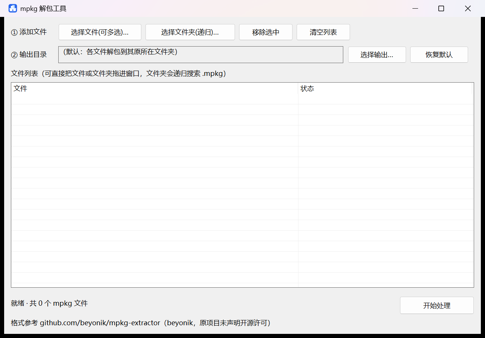
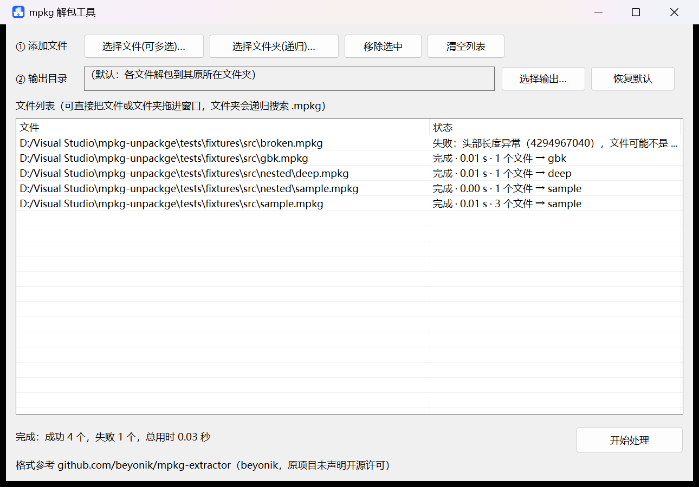

<p align="center">
  
</p>

# mpkg 解包工具（GUI 版）

一个用 **纯 Win32 API** 写的 MPKG 解包器：多选文件 / 递归文件夹、拖拽添加、后台批量处理，完成后显示每项状态与总用时。单文件 exe，运行时不依赖任何第三方库。

**原项目地址：<https://github.com/beyonik/mpkg-extractor>**　·　原作者：**beyonik**

| 主界面 | 处理完成 |
| --- | --- |
|  |  |

---

## 来源与署名

| 来源 | 地址 / 作者 | 本仓库中的对应内容 |
| --- | --- | --- |
| **上游原始项目** | **[beyonik/mpkg-extractor](https://github.com/beyonik/mpkg-extractor)** · 作者 **beyonik**（最后更新 2023-08） | 定义 `PKGM0014` 容器格式，参考其 `src/main.c`（按 `start_pos` 定位数据区）。**仅作格式参考与署名标注** |
| 本地 CLI 前身 | `mpkg-unpackge_fixed.cpp`（本仓库根目录，原文件未改动） | 「顺序读取数据区」版解包实现，`mpkg_core.h` 的解包算法由它移植而来 |
| 本仓库新增 | 本仓库维护者 | `mpkg_gui.cpp`、`mpkg_core.h`、图标、`tools/`、回归测试 |

> **许可状态（如实标注）**：上游仓库**未声明任何开源许可**——GitHub API 返回 `license: null`，仓库内也没有 LICENSE 文件，仅有 `.gitignore`、`Makefile`、`src/main.c` 三个文件。
> 因此本仓库**不分发上游代码**：本地 `reference/mpkg-extractor-master/` 只用于对照，已由 `.gitignore` 排除，不会上传。
> 本仓库也不对上游代码的权利作任何声明；若要公开发布或再分发衍生实现，请先自行确认授权。
> 本仓库新增的 GUI 代码、测试与图标由维护者提供，正式发布前建议补一份 `LICENSE`。

---

## 功能

- **第一行**：选择文件（可多选）／选择文件夹（递归搜索所有子文件夹里的 `.mpkg`），另有「移除选中」「清空列表」。
- **第二行**：选择统一输出目录；留空则每个包解包到**它自己所在文件夹**下（`输出位置/包名/` 子目录，与 CLI 版一致）。
- **列表区**：两列（文件 / 状态），支持把文件或文件夹直接拖进窗口；同批同名包自动分成 `xxx`、`xxx (2)`，不会互相覆盖；鼠标悬停状态列可看完整错误信息。
- **后台处理**：工作线程逐条解包，界面不卡；每行显示「完成 · 0.01 s · 3 个文件 → sample」或「失败：…」，底部汇总「完成：成功 4 个，失败 1 个，总用时 0.03 秒」。处理期间阻止关闭窗口，避免写出半个包。
- **其它**：把文件/文件夹拖到 `mpkg_gui.exe` 图标上启动也会自动载入列表；布局按系统 DPI 等比缩放（已验证 150% 缩放）。
- **健壮性**：头部数值合理性校验、`..` 路径穿越防护；包内文件名先按 UTF-8 解码，失败回退系统 ANSI(GBK)，解决中文 Windows 下的乱码。

> 解包沿用 `mpkg-unpackge_fixed.cpp` 的**顺序读取数据区**方式，未改用上游 `start_pos + header_end` 的定位逻辑。绝大多数包两者等价；若遇到按 `start_pos` 乱序排列、顺序读会解错的包，需要提供样本后调整。

---

## 文件树

```
mpkg-unpackge/
├─ README.md                      本说明（含上游原地址与署名）
├─ .gitignore / .gitattributes    忽略规则 / 行尾约定
├─ build_gui.bat                  一键编译（CRLF 行尾）
├─ mpkg_gui.cpp                   GUI 主程序（Win32 窗口、列表、拖放、后台线程）
├─ mpkg_core.h                    解包核心（GUI 与回归测试共用）
├─ mpkg_gui.rc                    应用图标资源声明
├─ mpkg-unpackge_fixed.cpp        原 CLI 源码，原样保留，作为算法来源
├─ assets/
│  ├─ mpkg-icon.svg               矢量图标源文件（可直接当仓库头像 / social preview）
│  ├─ mpkg-icon.ico               多尺寸图标 16/24/32/48/64/128/256，供 exe 资源使用
│  ├─ mpkg-icon.png               256×256 位图预览
│  └─ screenshots/
│     ├─ gui_main.png             主界面截图
│     └─ gui_done.png             处理完成截图
├─ tools/
│  └─ make_icon.py                由同一套几何重新生成 .ico / .png
└─ tests/
   └─ self_test.cpp               30 项回归测试（合成样本、拖拽消息、端到端处理）

本地保留、不上传：
├─ reference/                     ❌ 上游代码（无许可）、旧 CLI 程序与副本、旧编译说明
├─ mpkg_gui.exe                   ❌ 编译产物，走 Releases 附件分发
└─ tests/fixtures/                ❌ 运行测试时自动生成的合成样本与解包输出
```

---

## 使用

双击 `mpkg_gui.exe` → 选文件或文件夹（也可直接拖进列表）→ 需要时设置输出目录 → 点「开始处理」。

也可以把文件或文件夹直接拖到 `mpkg_gui.exe` 的图标上启动，程序会把命令行参数当作待处理路径自动载入。

---

## 编译

双击 `build_gui.bat`（找不到 `cl.exe` 时会自动调用 `vcvars64.bat`），或在 VS 的 Developer Command Prompt 里执行：

```bat
rc /nologo /fo mpkg_gui.res mpkg_gui.rc
cl /nologo /std:c++17 /EHsc /O2 /utf-8 /DUNICODE /D_UNICODE /Fe:mpkg_gui.exe mpkg_gui.cpp mpkg_gui.res /link /SUBSYSTEM:WINDOWS
```

本机实测环境：MSVC 14.51.36231 + Windows SDK 10.0.26100.0。C++ 源码是 UTF-8 with BOM；`.bat` 必须保持 CRLF（`.gitattributes` 已保证 clone 后仍是 CRLF）。

重新生成图标（仅此时需要 Pillow，编译和运行 exe 都不需要）：

```bat
python tools/make_icon.py
```

---

## 回归测试

```bat
build_gui.bat test
```

`tests/self_test.cpp` 通过 `#define` 把 GUI 的入口改名后整体包含进来，在**不显示窗口、不需要真实 mpkg 文件**的情况下跑 30 项检查：格式解析、中文 UTF-8 / GBK 文件名、嵌套目录、损坏包拒绝、`..` 越界拒绝、递归搜集、去重/移除/清空、真实 `WM_DROPFILES` 拖拽消息、后台线程端到端完成与用时汇总。

运行前会清空并重建 `tests/fixtures/`，生成 5 个合成 `.mpkg`（含中文名、嵌套目录、故意损坏的包）和一个 `note.txt`，可以直接拖进 GUI 试跑。

---

## 无外部依赖

`dumpbin /DEPENDENTS` 只有 7 个 Windows 系统 DLL：`USER32 / GDI32 / COMCTL32 / COMDLG32 / SHELL32 / ole32 / KERNEL32`；CRT 静态链接，二进制里没有 `VCRUNTIME140.dll` / `MSVCP140.dll`。单个 exe 拷到别的 Windows 机器即可运行。

---

## 发布说明

- `mpkg_gui.exe` 被 `.gitignore` 排除，不提交进仓库；分发请上传到仓库的 **Releases** 附件。
- `assets/mpkg-icon.svg` 可直接用作仓库头像或 social preview。
- `reference/` 内的上游代码未获明确授权，**请勿一并上传**。
